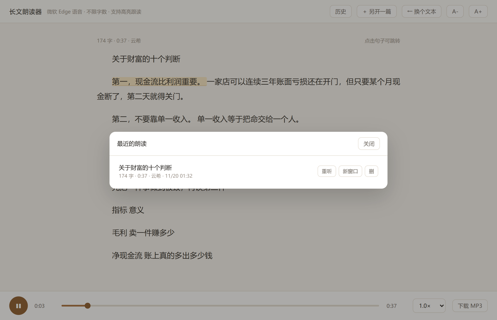

# 长文朗读器 · ReadAloud

把长文粘进来，它念给你听。

一个跑在本机的中文朗读工具：**不限字数**、逐句高亮、可导出 MP3。两万字的长报告一次读完，不用再被"最多 5000 字"卡住。


---

## 下载（最省事的方式）

不用 git、不用命令行，点一下就下载：

**[⬇ 下载压缩包](https://github.com/dingxiansheng11/tts-reader/archive/refs/heads/main.zip)**

解压，然后：

- **Windows**：双击 `start.bat`
- **macOS / Linux**：在终端里执行 `bash start.sh`

第一次运行会自动装依赖，装完浏览器自己弹出来。以后每次都是双击同一个文件。

> 前提：这台电脑要有 Python 3.10 或更新版本。没装的话，`start.bat` 会直接把下载地址告诉你，不会一闪而过。

---

## 为什么做这个

看长文字容易累，听就轻松得多。但现成的在线朗读站几乎都有字数上限——那是它们的排队规则，不是技术限制。

这个工具把同一套语音能力搬到你自己电脑上：本地起一个服务，字数是你的硬盘决定的，不是别人的服务器。

**核心取舍（先看这段，能省你几小时）：**

它用的是微软 Edge 的在线语音接口（`edge-tts`），不是本地大模型。因为"读长文"这件事要的是自然、稳定、能一口气读完，不需要克隆谁的声音。而 CosyVoice / VoxCPM 这类本地模型要 8GB 以上显存才跑得动，4GB 显存的笔记本上会慢到没法用。

代价很明确：**需要联网，文字会发到微软服务器**。要读不能外传的材料，请走本地模型方案，见 [`references/selection.md`](references/selection.md)。

## 特性

- **不限字数** — 上限 30 万字（约 20 小时音频），两万字约 4 分钟合成完
- **逐句高亮** — 用接口返回的真实时间戳对齐，不是按字数估算；点任意一句从头念
- **可以同时听两篇** — 每个朗读跑在自己的标签页里，开第二篇不会打断第一篇
- **朗读历史** — 读过的自动记在本地，下次想重听点一下就开，不用再粘贴
- **自动清洗 Markdown** — 从 AI 对话框直接粘过来，`**`、`#`、表格竖线、反引号都不会被念出来
- **14 个中文音色** — 普通话 6 个、东北话、陕西话、粤语 3 个、台湾 3 个，按地区分组
- **秒开缓存** — 合成过的文章按内容哈希存本地，再听同一篇不重新合成
- **可拖进度** — 支持 HTTP Range，75 分钟的音频也能随意跳转
- **导出 MP3** — 一个文件带走，手机离线反复听
- **无重量级依赖** — 服务端只用 Python 标准库，唯一第三方依赖是 `edge-tts`；不需要 ffmpeg、不需要显卡、不需要前端框架
- **单文件前端** — `index.html` 零外部资源，断网也能打开界面
- **记得你的习惯** — 文本、音色、语速、字号、播放倍速都存在浏览器本地
- **手机也能用** — 云端版用手机浏览器直接打开就行，窄屏自动折行、不放大、不溢出；iPhone 的自动放音限制也做了兜底

## 快速开始

### 方式一：解压就用（推荐）

下载压缩包 → 解压到任意目录 → 双击 `start.bat`（macOS / Linux 用 `bash start.sh`）。

依赖会自动装。装好后浏览器会打开 `http://127.0.0.1:8731/`，端口被占用会自动顺延。

### 方式二：装到固定目录

适合想固定路径的情况：

```bash
git clone https://github.com/dingxiansheng11/tts-reader.git
cd tts-reader
python scripts/install.py --target "D:/Tools/TTSReader"
```

之后双击 `D:/Tools/TTSReader/start.bat` 即可。

### 方式三：只想跑起来看看

```bash
pip install -r requirements.txt
python app.py
```

### 用法

1. 把文字粘进大框（直接从 Word、公众号、PDF、AI 对话框复制的都行）
2. 选音色和语速，点「开始朗读」
3. 第一次要等合成，进度条会走；完成后自动播放并开始高亮
4. 空格键播放/暂停，点正文任意一句从那里开始

**同时听两篇**：正在听的时候，点右上角「＋ 另开一篇」，会开一个新标签页。在新标签里粘另一篇、点开始朗读，两篇各播各的，第一篇不会被打断。

**回到首页重来**：点左上角的「长文朗读器」（下面那行小字写着「点一下清空重来」），会停掉正在放的、退回空白首页、把输入框清空。**朗读历史不受影响**，读过的还在「历史」里，随时能重听。想保留刚粘的文字、只是回到编辑状态，用朗读页右上角的「← 换个文本」。

**重听以前的内容**：点右上角「历史」，里面按时间列着读过的每一篇，点「重听」在当前页打开，点「新窗口」另开一页（可以两篇对比着听）。历史存在浏览器本地，换浏览器或清缓存会丢，但音频文件还在本机 `cache/` 里。



**Markdown 不用手动清**：输入框上方有个「清洗 Markdown 符号」，默认勾着。勾上之后，`**粗体**`、`# 标题`、`> 引用`、`- 列表`、`` `代码` ``、`[文字](链接)`、表格竖线都会被去掉，只念文字。想保留原样朗读就取消勾选。

## 把工具发给别人

整个目录就是交付物，不需要联网下载别的东西（依赖会自动装）。

**对方在用 WorkBuddy 之类的 AI 工具**：把文件夹路径发过去，让他说一句「按这个目录里的 SKILL.md 装好并启动」，剩下的对方 AI 会自己办。

**对方不用 AI 工具**：解压，Windows 双击 `start.bat`，macOS / Linux 执行 `bash start.sh`。

前提只有一个：对方电脑装有 Python 3.10 以上。没有的话安装脚本会打印下载地址，装的时候记得勾选「Add Python to PATH」。

中国大陆网络直连 PyPI 可能超时，安装脚本会自动切换清华、阿里云镜像；也可手动指定：

```bash
python scripts/install.py --mirror tsinghua
```

发给别人时**不要带 `cache/` 目录**，那是本机的合成缓存，几十 MB 且对你对方无用。

## 工作原理

```
粘贴文本
   │
   ├─ 按行 → 按句切片（700 字/片，避免在半句话处断开）
   │
   ├─ 逐片调 edge-tts → 拿到音频字节 + 句子级时间戳
   │
   ├─ 字节拼接成单个 MP3（48kbps CBR）
   │     └─ 跨片时间轴补偿：base_ticks = cum_bytes × 8 × 10⁷ ÷ 48000
   │
   ├─ 时间戳按顺序回填到原文字符区间（保证首尾相接、不重叠）
   │
   └─ 前端：audio.currentTime → 二分查找 → 高亮当前句
```

三个容易踩的实现细节，写在这里供改代码的人参考：

**时间轴补偿用字节数，不累加时长。** 输出是恒定码率（48kbps 单声道），所以"字节数 ÷ 6000 = 精确秒数"。这是整数运算，没有浮点累积误差——实测 3229 字、5 个分片、10 分钟音频，末段位置偏差 0.1%。

**`edge-tts` 7.x 返回的是 `SentenceBoundary`。** 不是旧教程里的 `WordBoundary`；offset 单位是 100 纳秒（`28625000` = 2.8625 秒）。用旧写法在 7.x 上会拿到 0 条事件。

**长音频必须支持 Range。** 只返回 `Content-Length` 不处理 `Range`，浏览器拖动会失效、时长可能显示为 Infinity。

## 音色

Edge 接口上能拿到的中文音色一共 14 个，全部已内置，界面上按地区分组：

- **普通话**（大陆）：云希（默认，男·自然亲和）、晓晓（女·温柔清晰）、云扬（男·新闻播报）、晓伊（女·年轻活泼）、云健（男·浑厚有力）、云夏（男·少年感）
- **方言**：晓北（东北话·女）、晓妮（陕西话·女）
- **粤语**：晓曼（女）、晓佳（女）、云龙（男）
- **台湾**：晓臻（女）、晓雨（女）、云哲（男）

方言和粤语、台湾音色读同一段普通话文字时，会带上自己的发音习惯，适合做地区口播，不适合当标准普通话用。

**关于「云泽」**：`zh-CN-YunzeNeural`（云泽）在微软 Azure 付费语音库里，Edge 这条免费接口取不到。实测把 `YunzeNeural`、`YunyeNeural`、`YunfengNeural`、`YunhaoNeural`、`YunqingNeural`、`YunbaiNeural` 六个候选名逐个试了一遍，全部返回 `NoAudioReceived`（没有音频），只有 `YunxiNeural` 正常。想用云泽需要自己开 Azure 语音订阅，那条路的代价是拿不到句子级时间戳，逐句高亮会失效。

音色表在 `app.py` 顶部 `VOICES` 字典里，键名用 `edge-tts` 的 ShortName，标签格式是「分组 · 名字 · 性别 · 特点」，前端按第一个「·」前的分组自动归类。想再扩，改字典就行。查接口当下真实可用的音色：

```bash
edge-tts --list-voices | grep zh-
```

其他可调项都在 `app.py` 顶部常量区：`CHUNK_CHARS`（切片大小，越小进度越细）、`MAX_CHARS`（字数上限）、`CACHE`（缓存目录）。

## 放到云上（打开网址就能用，不用装东西）

这个工具本质是一个单端口的 HTTP 服务，所以能直接托管。托管平台的要求只有两条：监听它注入的 `PORT` 环境变量、绑定 `0.0.0.0`。代码里已经处理好——检测到 `PORT` 就走云端模式，不去探测本机端口，也不试图打开浏览器；本机双击的用法完全不变。

用 WorkBuddy 的「发布应用」发布后，别人打开链接就能用，不需要装 Python。

两点代价要说清楚：

- 托管实例是**公用**的：谁拿到链接都能往里粘文字
- 粘进去的内容会发到微软服务器（`edge-tts` 是云端合成）

所以不适合外传的材料，别粘到公开链接里，用本机版。

## 手机上用

云端版的网址用手机浏览器（Safari、Chrome、微信里点开都行）直接打开就能用，不用装任何东西。唱戏的力气都在微软服务器上，手机只负责把文字发出去和放声音，所以老手机也不卡。

手机上跟电脑的几处不同：

- **没有「＋ 另开一篇」**。手机浏览器同一时间只会响一个标签页，开了也没用，所以窄屏下这个按钮收起来了
- **iPhone 合成完可能要先点一下 ▶**。苹果规定「必须是手指按下去的那一刻才能开始放音」，而我们的音频是服务器合成好才回来的，那时候手指早抬起来了。遇到这种情况顶部会提示「点下面的 ▶ 开始放音」，点一下就行，不用重新合成
- 播放条会折成两行，倍速和下载在第二行右边，都能点到

**发链接的时候要发全。** 地址后面那串 `?sharecode=...` 是通行码，少了它对方打开会看到「链接不完整」。微信里转发的时候，直接从地址栏复制整条链接最稳。

## 版本与回退
改坏了怎么办？这个项目按开源项目的通行做法留了三层保险，任何一层都够用。

**第一层：每个版本都是一个独立下载包。**
打开 [Releases](https://github.com/dingxiansheng11/tts-reader/releases)，每一版都挂着一个 zip。想退回哪一版就下哪一版，不依赖任何工具。

**第二层：版本号能看出「改了多大」。**
`1.1.0` 这种三位数字：最后一位变（1.1.**0** → 1.1.**1**）是修小毛病；中间一位变（1.**0**.2 → 1.**1**.0）是加了新功能，可能需要重新适应界面；第一位变是动了大结构。看着数字就知道要不要谨慎。

**第三层：每一版改了什么都有记录。**
[`CHANGELOG.md`](CHANGELOG.md) 按版本列着新增、修复、变更。出问题时先看这里，能判断是不是刚改出来的。

**具体怎么退（不用命令行）：**

1. 先去 Releases 下载想回到的那一版 zip
2. 解压，把里面的文件复制到你正在用的那个文件夹，提示「替换」就替换
3. 双击 `start.bat`

关键是**只覆盖程序文件，别删 `cache/` 目录**。`cache/` 里是已经合成好的音频，留着的话退回去之后不用重新合成。浏览器里的朗读历史也不受影响。

## 常见问题

**双击 `start.bat` 没反应，窗口一闪而过？**
`start.bat` 必须是 CRLF 换行。用 git 克隆或某些编辑器保存后会变成 LF，cmd 就会解析失败。转换一下即可：`python -c "d=open('start.bat','rb').read().replace(b'\r\n',b'\n').replace(b'\n',b'\r\n');open('start.bat','wb').write(d)"`

**启动后卡很久才出现页面？**
检查系统是否设了 `HTTP_PROXY`。程序已改为用 socket 探活规避此问题；若你自行改过代码，注意不要用 `urllib` 直接探本机端口。

**提示 403 或合成失败？**
微软接口偶发限流。程序会自动重试 3 次，仍失败就返回后重试一次。频繁失败通常是网络出口问题。

**音频拖不动 / 时长显示 Infinity？**
服务端 `Range` 处理被破坏了，检查 `_file()` 里的分段逻辑。

**能离线用吗？**
这个版本不行，`edge-tts` 是云端合成。离线需求请换本地模型，见 `references/selection.md`。

**倍速选了 1.5×，听着还是原速？**
1.1.0 已修。旧版只在手动切换下拉时写 `playbackRate`，而浏览器刷新后会自动恢复下拉的显示值、但不触发 `change`，于是出现「显示 1.5、实际 1.0」。现在加载音频、元数据就绪、开始播放三个时机都会重写一遍，并把选择存进 `localStorage`。

**历史记录存在哪？会不会丢？**
存在浏览器 `localStorage`（键名 `ra_hist_v1`），跟着这个浏览器走。清缓存、换浏览器、换端口都会看不到历史；但音频和原文仍在本机 `cache/` 目录里。历史里也存了原文，所以即使音频被清理，点重听会自动重新合成。

**新版用着不顺手，是不是得退回旧版？**
先别急着退。多数问题能直接修，退回旧版等于把新功能也一起丢了。真要退，按上面「版本与回退」三步走，注意别删 `cache/` 目录。

**能在手机上听吗？**
两种方式：点「下载 MP3」传手机；或把 `app.py` 里的 `127.0.0.1` 改成 `0.0.0.0`，手机连同一 WiFi 访问 `http://电脑IP:8731`（注意这样同网段设备都能访问）。

## 目录结构

```
tts-reader/
├── app.py                  # 服务端：切片、合成、拼接、时间轴、缓存、Range
├── index.html              # 单页前端，无外部依赖
├── start.bat               # Windows 一键启动（CRLF）
├── start.sh                # macOS / Linux 一键启动
├── scripts/
│   └── install.py          # 安装 + 依赖 + 冒烟测试
├── references/
│   ├── selection.md        # 选型对比、许可证与合规
│   └── troubleshooting.md  # 故障对照表
├── docs/
│   └── screenshot.png
├── cache/                  # 合成结果（git 忽略）
├── requirements.txt
├── CHANGELOG.md
└── LICENSE
```

## 已知限制

- 单次 30 万字上限；超过请分段
- 输出固定 48kbps 单声道，追求高音质需同时改输出格式与时间轴常量
- 长句（无标点）会按 700 字硬切，句内高亮会分多段
- 接口返回的句子切分与原文标点不完全一致时，靠顺序匹配兜底，极少数字符可能归到相邻句

## Roadmap

- [ ] 自动记住每篇文章的收听进度，下次接着听
- [ ] 批量把文件夹里的 Word / PDF / TXT 转成音频
- [ ] 多音字词表（中医、古文场景的专名纠音）
- [ ] 纯本地模型后端（可选，给涉密场景）

## 许可证

代码以 [MIT](LICENSE) 发布。语音合成由 Microsoft Edge 在线语音服务提供，使用须遵守其服务条款；本项目不包含、不分发任何语音模型。

用于对外发布内容时请注意：中国《民法典》第 1023 条规定自然人声音受保护（参照肖像权），克隆真人声音须取得本人书面授权；《人工智能生成合成内容标识办法》（2025-09-01 施行）要求对 AI 生成内容添加标识。本工具默认使用官方预置音色、不克隆真人。
