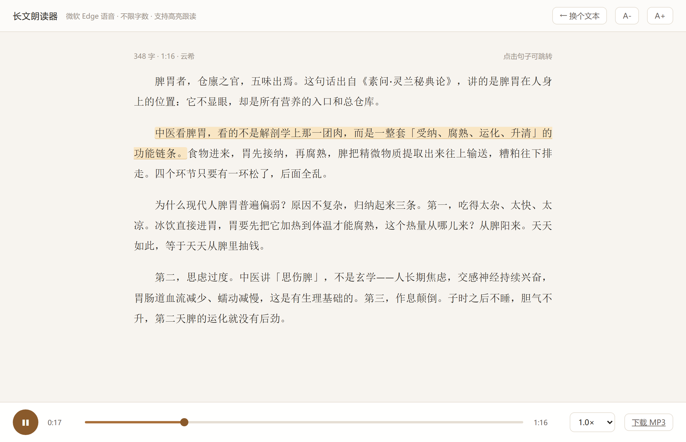

# 长文朗读器 · ReadAloud

把长文粘进来，它念给你听。

一个跑在本机的中文朗读工具：**不限字数**、逐句高亮、可导出 MP3。两万字的长报告一次读完，不用再被"最多 5000 字"卡住。




---

## 为什么做这个

看长文字容易累，听就轻松得多。但现成的在线朗读站几乎都有字数上限——那是它们的排队规则，不是技术限制。

这个工具把同一套语音能力搬到你自己电脑上：本地起一个服务，字数是你的硬盘决定的，不是别人的服务器。

**核心取舍（先看这段，能省你几小时）：**

它用的是微软 Edge 的在线语音接口（`edge-tts`），不是本地大模型。因为"读长文"这件事要的是自然、稳定、能一口气读完，不需要克隆谁的声音。而 CosyVoice / VoxCPM 这类本地模型要 8GB 以上显存才跑得动，4GB 显存的笔记本上会慢到没法用。

代价很明确：**需要联网，文字会发到微软服务器**。要读不能外传的材料，请走本地模型方案，见 [`references/selection.md`](references/selection.md)。

## 特性

- **不限字数** — 上限 30 万字（约 20 小时音频），两万字约 4 分钟合成完
- **逐句高亮** — 用接口返回的真实时间戳对齐，不是按字数估算；点任意一句从头念
- **秒开缓存** — 合成过的文章按内容哈希存本地，再听同一篇不重新合成
- **可拖进度** — 支持 HTTP Range，75 分钟的音频也能随意跳转
- **导出 MP3** — 一个文件带走，手机离线反复听
- **无重量级依赖** — 服务端只用 Python 标准库，唯一第三方依赖是 `edge-tts`；不需要 ffmpeg、不需要显卡、不需要前端框架
- **单文件前端** — `index.html` 零外部资源，断网也能打开界面
- **记得你的习惯** — 文本、音色、字号存在浏览器本地

## 快速开始

### Windows

```bash
git clone <this-repo> && cd tts-reader
python scripts/install.py --target "D:/Tools/TTSReader"
```

然后双击 `D:/Tools/TTSReader/start.bat`，浏览器会自动打开。

### 手动

```bash
pip install -r requirements.txt
python app.py
```

默认地址 `http://127.0.0.1:8731/`，端口被占用会自动顺延。

### 用法

1. 把文字粘进大框（直接从 Word、公众号、PDF 复制的都行）
2. 选音色和语速，点「开始朗读」
3. 第一次要等合成，进度条会走；完成后自动播放并开始高亮
4. 空格键播放/暂停，点正文任意一句从那里开始

## 把工具发给别人

整个目录就是交付物，不需要联网下载别的东西（依赖会自动装）。

**对方在用 WorkBuddy 之类的 AI 工具**：把文件夹路径发过去，让他说一句「按这个目录里的 SKILL.md 装好并启动」，剩下的对方 AI 会自己办。

**对方不用 AI 工具**：解压，Windows 双击 `start.bat`，macOS / Linux 执行 `bash start.sh`。

前提只有一个：对方电脑装有 Python 3.10 以上。没有的话安装脚本会打印下载地址，装的时候记得勾选「Add Python to PATH」。

中国大陆网络直连 PyPI 可能超时，安装脚本会自动切换清华、阿里云镜像；也可手动指定：

```bash
python scripts/install.py --mirror tsinghua
```

发给别人时**不要带 `cache/` 目录**，那是本机的合成缓存，几十 MB 且对你对方无用。

## 工作原理

```
粘贴文本
   │
   ├─ 按行 → 按句切片（700 字/片，避免在半句话处断开）
   │
   ├─ 逐片调 edge-tts → 拿到音频字节 + 句子级时间戳
   │
   ├─ 字节拼接成单个 MP3（48kbps CBR）
   │     └─ 跨片时间轴补偿：base_ticks = cum_bytes × 8 × 10⁷ ÷ 48000
   │
   ├─ 时间戳按顺序回填到原文字符区间（保证首尾相接、不重叠）
   │
   └─ 前端：audio.currentTime → 二分查找 → 高亮当前句
```

三个容易踩的实现细节，写在这里供改代码的人参考：

**时间轴补偿用字节数，不累加时长。** 输出是恒定码率（48kbps 单声道），所以"字节数 ÷ 6000 = 精确秒数"。这是整数运算，没有浮点累积误差——实测 3229 字、5 个分片、10 分钟音频，末段位置偏差 0.1%。

**`edge-tts` 7.x 返回的是 `SentenceBoundary`。** 不是旧教程里的 `WordBoundary`；offset 单位是 100 纳秒（`28625000` = 2.8625 秒）。用旧写法在 7.x 上会拿到 0 条事件。

**长音频必须支持 Range。** 只返回 `Content-Length` 不处理 `Range`，浏览器拖动会失效、时长可能显示为 Infinity。

## 配置

音色在 `app.py` 顶部 `VOICES` 字典里，键名用 `edge-tts` 的 ShortName：

| 音色 | 说明 |
| --- | --- |
| `zh-CN-YunxiNeural` | 云希 · 男声 · 自然亲和（默认） |
| `zh-CN-XiaoxiaoNeural` | 晓晓 · 女声 · 温柔清晰 |
| `zh-CN-YunyangNeural` | 云扬 · 男声 · 新闻播报 |
| `zh-CN-XiaoyiNeural` | 晓伊 · 女声 · 年轻活泼 |
| `zh-CN-YunjianNeural` | 云健 · 男声 · 浑厚有力 |
| `zh-CN-YunxiaNeural` | 云夏 · 男声 · 少年感 |

想加方言，把 `zh-CN-liaoning-XiaobeiNeural`（东北话）、`zh-CN-shaanxi-XiaoniNeural`（陕西话）加进字典即可。查全部可用音色：

```bash
edge-tts --list-voices | grep zh-CN
```

其他可调项都在 `app.py` 顶部常量区：`CHUNK_CHARS`（切片大小，越小进度越细）、`MAX_CHARS`（字数上限）、`CACHE`（缓存目录）。

## 常见问题

**双击 `start.bat` 没反应，窗口一闪而过？**
`start.bat` 必须是 CRLF 换行。用 git 克隆或某些编辑器保存后会变成 LF，cmd 就会解析失败。转换一下即可：`python -c "d=open('start.bat','rb').read().replace(b'\r\n',b'\n').replace(b'\n',b'\r\n');open('start.bat','wb').write(d)"`

**启动后卡很久才出现页面？**
检查系统是否设了 `HTTP_PROXY`。程序已改为用 socket 探活规避此问题；若你自行改过代码，注意不要用 `urllib` 直接探本机端口。

**提示 403 或合成失败？**
微软接口偶发限流。程序会自动重试 3 次，仍失败就返回后重试一次。频繁失败通常是网络出口问题。

**音频拖不动 / 时长显示 Infinity？**
服务端 `Range` 处理被破坏了，检查 `_file()` 里的分段逻辑。

**能离线用吗？**
这个版本不行，`edge-tts` 是云端合成。离线需求请换本地模型，见 `references/selection.md`。

**能在手机上听吗？**
两种方式：点「下载 MP3」传手机；或把 `app.py` 里的 `127.0.0.1` 改成 `0.0.0.0`，手机连同一 WiFi 访问 `http://电脑IP:8731`（注意这样同网段设备都能访问）。

## 目录结构

```
tts-reader/
├── app.py                  # 服务端：切片、合成、拼接、时间轴、缓存、Range
├── index.html              # 单页前端，无外部依赖
├── start.bat               # Windows 一键启动（CRLF）
├── start.sh                # macOS / Linux 一键启动
├── scripts/
│   └── install.py          # 安装 + 依赖 + 冒烟测试
├── references/
│   ├── selection.md        # 选型对比、许可证与合规
│   └── troubleshooting.md  # 故障对照表
├── docs/
│   └── screenshot.png
├── cache/                  # 合成结果（git 忽略）
├── requirements.txt
├── CHANGELOG.md
└── LICENSE
```

## 已知限制

- 单次 30 万字上限；超过请分段
- 输出固定 48kbps 单声道，追求高音质需同时改输出格式与时间轴常量
- 长句（无标点）会按 700 字硬切，句内高亮会分多段
- 接口返回的句子切分与原文标点不完全一致时，靠顺序匹配兜底，极少数字符可能归到相邻句

## Roadmap

- [ ] 自动记住每篇文章的收听进度，下次接着听
- [ ] 批量把文件夹里的 Word / PDF / TXT 转成音频
- [ ] 多音字词表（中医、古文场景的专名纠音）
- [ ] 纯本地模型后端（可选，给涉密场景）

## 许可证

代码以 [MIT](LICENSE) 发布。语音合成由 Microsoft Edge 在线语音服务提供，使用须遵守其服务条款；本项目不包含、不分发任何语音模型。

用于对外发布内容时请注意：中国《民法典》第 1023 条规定自然人声音受保护（参照肖像权），克隆真人声音须取得本人书面授权；《人工智能生成合成内容标识办法》（2025-09-01 施行）要求对 AI 生成内容添加标识。本工具默认使用官方预置音色、不克隆真人。
